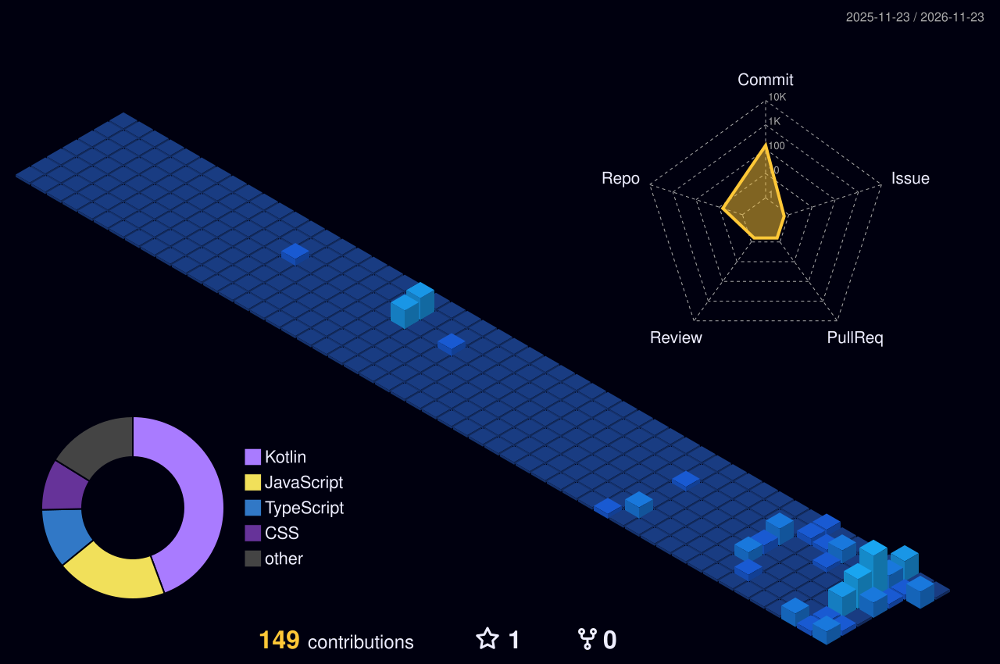

<!-- ═══════════════════════════════════════════════════════════════════════ -->
<!--                    BESPOKE ANIMATED HERO CARD                          -->
<!-- ═══════════════════════════════════════════════════════════════════════ -->
<p align="center">
  <a href="https://thanhphong28.github.io/"></a>
</p>

<!-- ═══════════════════════════════════════════════════════════════════════ -->
<!--                    SINGLE-ROW SOCIAL & ACTION BAR                      -->
<!-- ═══════════════════════════════════════════════════════════════════════ -->
<p align="center">
  <a href="https://thanhphong28.github.io/"></a>&nbsp;<a href="mailto:777thanhphong@gmail.com"></a>&nbsp;<a href="https://www.facebook.com/breezeboy281/"></a>&nbsp;<a href="https://www.instagram.com/breezeboy.777"></a>&nbsp;<a href="https://www.youtube.com/channel/UCfE5dCYT9qLvIP8dM07bSCw"></a>&nbsp;
</p>

<p align="center"></p>

<!-- ═══════════════════════════════════════════════════════════════════════ -->
<!--                    ENGINEERING DNA (2-COLUMN BENTO)                    -->
<!-- ═══════════════════════════════════════════════════════════════════════ -->
<h3><code>01 //</code> Engineering DNA</h3>

<table width="100%">
  <tr>
    <td width="52%" valign="top">

```ts
const breezeBoy = {
  role: "Frontend Software Engineer",
  company: "315 Medical (~200 clinics)",
  education: "B.Eng. Software Eng (SGU)",
  location: "Ho Chi Minh City, VN",
  focus: [
    "React / Next.js Architecture",
    "High-Performance UI & Motion",
    "Android System & DevTools",
  ],
  mindset: "Product-Minded Engineer",
};
```

  </td>
    <td width="48%" valign="top">

**Track Record & Impact**

🏥 **Frontend Engineer @ 315 Medical**<br/>
Building & scaling core EMR modules serving ~200 clinics daily.

👑 **Ex-Team Lead @ VNA Group**<br/>
Led a 5-engineer Next.js & NestJS team on a provincial safety platform.

⚡ **Indie Product Builder**<br/>
Creator of *Antigravity Board*, *BreezeIsland* (Z Flip 5), and *BreezeOS*.

🏅 **Certified** — Google UX Design · Google AI Essentials · TOEIC.

> *"Code that creates real business value."*

  </td>
  </tr>
</table>

<p align="center"></p>

<!-- ═══════════════════════════════════════════════════════════════════════ -->
<!--                  FEATURED WORK (EQUAL-HEIGHT 2x2 GRID)                 -->
<!-- ═══════════════════════════════════════════════════════════════════════ -->
<h3><code>02 //</code> Featured Products &amp; Open Source</h3>

<table width="100%">
  <tr>
    <td width="50%" valign="top">
      <h4>📊 <a href="https://github.com/thanhphong28/antigravity-board">Antigravity Board</a></h4>
      <p>Local analytics dashboard plugin for Google Antigravity — tracking agent sessions, tokens, estimated cost &amp; 12-week heatmap.</p>
      <p><code>JavaScript</code> <code>Plugin</code> <code>BreezeAI</code></p>
    </td>
    <td width="50%" valign="top">
      <h4>🏝️ <a href="https://github.com/thanhphong28/BreezeIsland">BreezeIsland</a></h4>
      <p>Native Dynamic Island for Samsung Galaxy Z Flip 5 (One UI 9) with spring physics — zero root &amp; zero accessibility services.</p>
      <p><code>Kotlin</code> <code>Android</code> <code>Spring Physics</code></p>
    </td>
  </tr>
  <tr>
    <td width="50%" valign="top">
      <h4>🎨 <a href="https://github.com/thanhphong28/antigravity-breeze-boy-theme">Breeze Boy Theme</a></h4>
      <p>Signature Kakashi ANBU Live custom theme for Antigravity IDE featuring HUD accents and a 1-click Windows installer.</p>
      <p><code>JavaScript</code> <code>CSS</code> <code>UI/UX</code></p>
    </td>
    <td width="50%" valign="top">
      <h4>💑 <a href="https://github.com/thanhphong28/schedule-couple">Couple Schedule</a> · <a href="https://schedule-couple.vercel.app/">Live Demo →</a></h4>
      <p>Real-time synced master schedule web app engineered for native-like responsiveness, clean state &amp; instant sync.</p>
      <p><code>React 19</code> <code>Vite</code> <code>Supabase</code></p>
    </td>
  </tr>
</table>

<p align="center"></p>

<!-- ═══════════════════════════════════════════════════════════════════════ -->
<!--                   TECH STACK (UNIFORM 8x2 ICON DOCK)                   -->
<!-- ═══════════════════════════════════════════════════════════════════════ -->
<h3><code>03 //</code> Core Stack &amp; Toolbox</h3>

<p align="center">
  <br/><br/>
  
</p>

<p align="center"></p>

<!-- ═══════════════════════════════════════════════════════════════════════ -->
<!--                GITHUB TELEMETRY (ALIGNED 2-COLUMN BENTO)               -->
<!-- ═══════════════════════════════════════════════════════════════════════ -->
<h3><code>04 //</code> GitHub Telemetry &amp; Activity</h3>

<table width="100%">
  <tr>
    <td width="50%" align="center" valign="middle">
      
    </td>
    <td width="50%" align="center" valign="middle">
      
    </td>
  </tr>
  <tr>
    <td width="50%" align="center" valign="middle">
      
    </td>
    <td width="50%" align="center" valign="middle">
      
    </td>
  </tr>
</table>

<p align="center">
  
</p>

<p align="center">
  <picture>
    <source media="(prefers-color-scheme: dark)" srcset="https://raw.githubusercontent.com/thanhphong28/thanhphong28/output/github-snake-dark.svg" />
    <source media="(prefers-color-scheme: light)" srcset="https://raw.githubusercontent.com/thanhphong28/thanhphong28/output/github-snake.svg" />
    
  </picture>
</p>

<details>
  <summary>🏙️ <strong>Explore 3D Isometric Contribution Skyline</strong></summary>
  <br/>
  <p align="center">
    <picture>
      <source media="(prefers-color-scheme: dark)" srcset="./profile-3d-contrib/profile-night-view.svg" />
      <source media="(prefers-color-scheme: light)" srcset="./profile-3d-contrib/profile-green-animate.svg" />
      
    </picture>
  </p>
</details>

<br/>

<!-- ═══════════════════════════════════════════════════════════════════════ -->
<!--                          BESPOKE FOOTER CARD                           -->
<!-- ═══════════════════════════════════════════════════════════════════════ -->
<p align="center">
  <a href="https://thanhphong28.github.io/"></a>
</p>
