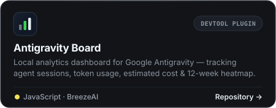
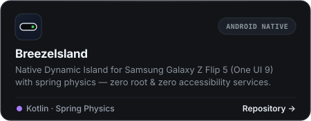
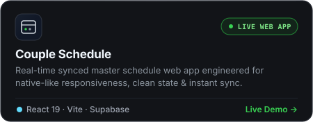
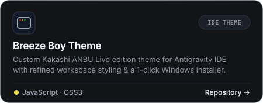
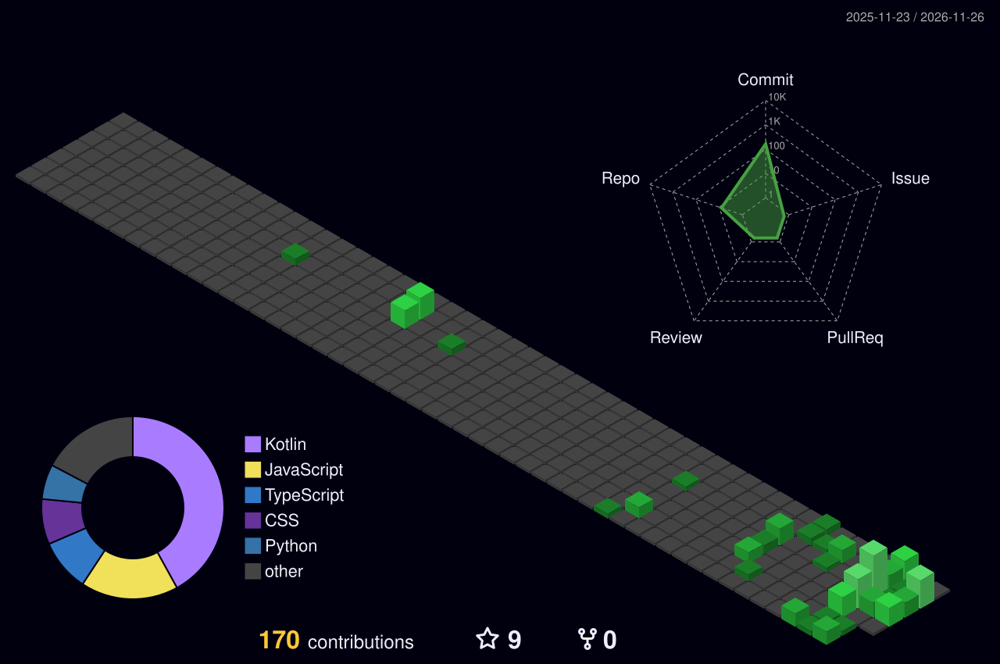

<!-- ═══════════════════════════════════════════════════════════════════════ -->
<!--            LIVE AUTO-UPDATING macOS TERMINAL NEOFETCH                  -->
<!-- ═══════════════════════════════════════════════════════════════════════ -->

  

<!-- ═══════════════════════════════════════════════════════════════════════ -->
<!--                    SINGLE-ROW SOCIAL & PORTFOLIO BAR                   -->
<!-- ═══════════════════════════════════════════════════════════════════════ -->

  &nbsp;&nbsp;&nbsp;&nbsp;&nbsp;

 

<!-- ═══════════════════════════════════════════════════════════════════════ -->
<!--            FEATURED PROJECTS (APPLE / LINEAR BENTO CARDS)              -->
<!-- ═══════════════════════════════════════════════════════════════════════ -->
### Featured Projects

  &nbsp;

  &nbsp;

 

<!-- ═══════════════════════════════════════════════════════════════════════ -->
<!--                 STACK & TOOLS (FULL 27-ICON 3x9 DOCK)                  -->
<!-- ═══════════════════════════════════════════════════════════════════════ -->
### Stack & Tools

<strong>Frontend &amp; UI</strong>

<strong>Backend, Mobile &amp; Databases</strong>

<strong>Cloud, Dev &amp; Design Tools</strong>

 

<!-- ═══════════════════════════════════════════════════════════════════════ -->
<!--            GITHUB OVERVIEW (UNIFIED ROUNDED BORDERLESS CARDS)          -->
<!-- ═══════════════════════════════════════════════════════════════════════ -->
### GitHub Overview

  &nbsp;

  &nbsp;

  

  <picture>
    <source media="(prefers-color-scheme: dark)" srcset="https://raw.githubusercontent.com/thanhphong28/thanhphong28/output/github-snake-dark.svg" />
    <source media="(prefers-color-scheme: light)" srcset="https://raw.githubusercontent.com/thanhphong28/thanhphong28/output/github-snake.svg" />
    
  </picture>

  
View 3D Contribution Graph

   
  

    <picture>
      <source media="(prefers-color-scheme: dark)" srcset="./profile-3d-contrib/profile-night-green.svg" />
      <source media="(prefers-color-scheme: light)" srcset="./profile-3d-contrib/profile-green-animate.svg" />
      
    </picture>
  

 

  Always happy to chat about frontend architecture, UI craft, or interesting ideas — reach out at <a href="mailto:777thanhphong@gmail.com">777thanhphong@gmail.com</a>.

